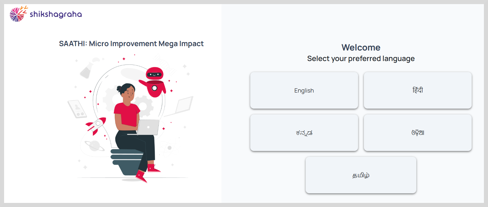
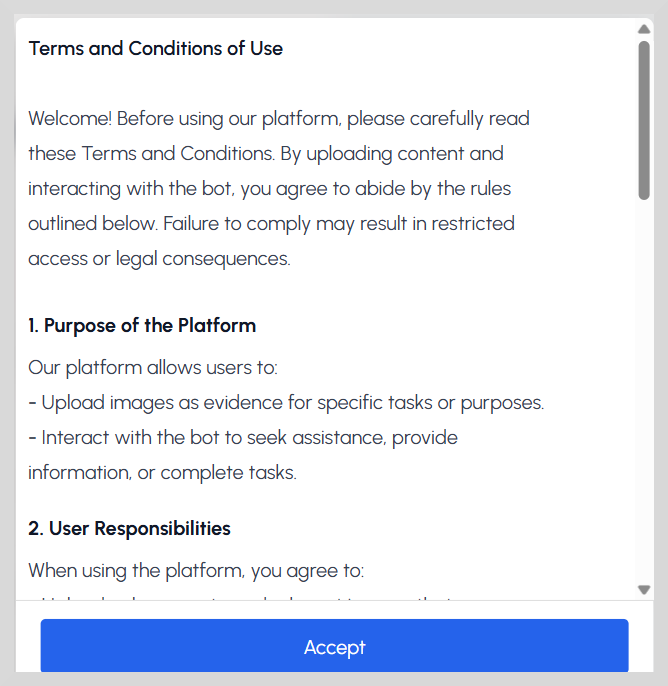
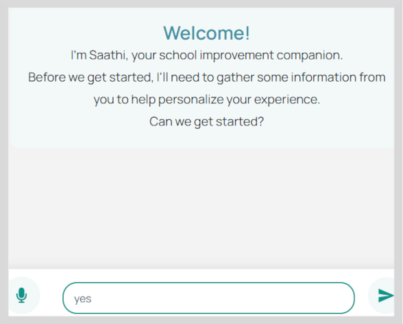
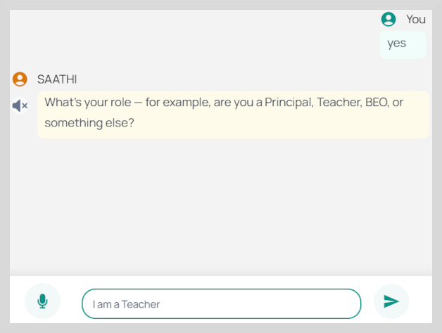
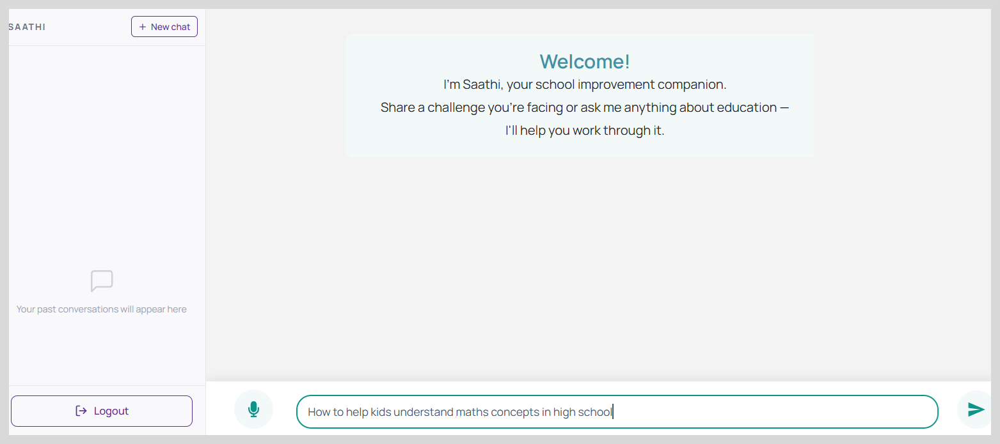

import Admonition from '@theme/Admonition';

# Addressing Challenges and Solutions

1. On the Welcome page, select your preferred language as shown in the following figure.

2. After you select the language, the Terms and Conditions of Use page appears.

3. Click **Accept** on the Terms and Conditions of Use page. The following page appears.

4. Start chatting with Saathi or type your queries in the text box provided.

* To chat with Saathi, click the microphone icon to record and stop recording when finished.

* Type the information in detail in the text box provided and then click send.

5. Type or record any issue about education that you are facing in the text box provided and then click send.

    <Admonition type="note"> 
    
Saathi is designed exclusively for educational purposes.
    It provides information, guidance, and support related to education, academic learning, and educational challenges.
     All queries should be related to education and learning. Saathi is not intended for any non-educational purposes, and queries unrelated to education are outside its scope.

     </Admonition>
    
 

6 The below example explains how Saathi provides action plans when there is a decline in school enrollment.

