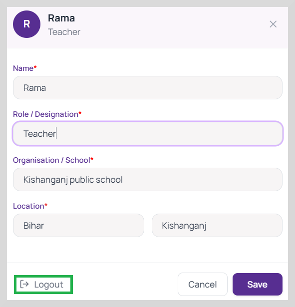

# Updating Your Profile

To update your profile, do as follows:

1. Click your name displayed on the lower-left of the screen. Your profile page appears.

2. Make the necessary changes.

3. Click Save to save the changes.

4. To logout from Saathi, click Logout.

